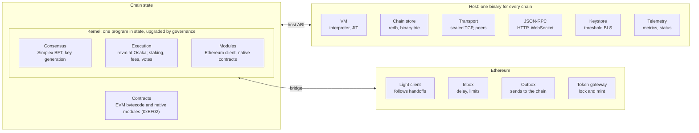

# OrangeSDK litepaper

Version 0.1 (draft), as of 2026-11-07. The first chain built with OrangeSDK is **tangerine**. The specification in [`spec/`](spec/README.md) is normative: where this paper and the specification disagree, the specification wins.

## Contents

1. [Abstract](#abstract)
2. [Why OrangeSDK](#why-orangesdk)
3. [Architecture](#architecture)
4. [The virtual machine](#the-virtual-machine)
5. [Consensus and networking](#consensus-and-networking)
6. [State and storage](#state-and-storage)
7. [Staking and the threshold key](#staking-and-the-threshold-key)
8. [Governance and upgrades](#governance-and-upgrades)
9. [Fees and the mempool](#fees-and-the-mempool)
10. [Ethereum compatibility](#ethereum-compatibility)
11. [Bridges](#bridges)
12. [Security and assurance](#security-and-assurance)
13. [Status and what comes next](#status-and-what-comes-next)

## Abstract

OrangeSDK is a framework for building EVM-compatible solochains, written from scratch with its own virtual machine. A chain built with it is two things: one host binary that every OrangeSDK chain shares, and a kernel that lives in chain state. The kernel holds everything that defines the chain: consensus, staking, governance, fees, the bridges and the EVM. Governance upgrades it on a running chain, with every node switching at the same block.

Chains are Type 2 Ethereum compatible. They run standard EVM bytecode at the Osaka fork with exact gas, produce Ethereum block headers, and serve the JSON-RPC that wallets, Foundry, ethers, viem and block explorers use. Finality comes from Simplex BFT with a fresh threshold BLS key each epoch. Its 97-byte certificates let a light client on Ethereum follow the chain. A sync-committee light client of Ethereum carries messages the other way, and a canonical token bridge runs over both channels.

The first chain built with OrangeSDK is **tangerine**. The design is set down in 23 normative specification documents; this paper summarises them.

## Why OrangeSDK

A team that wants its own EVM chain usually chooses between two poor options. One is to fork an Ethereum client and maintain the fork. The other is to adopt a large framework whose VM, consensus and upgrade machinery it does not control. Either way, changing consensus or the fee market means a coordinated binary release, and EVM compatibility is often approximate.

OrangeSDK takes a different approach:

- **The chain's rules are data, not a binary.** The kernel, consensus included, is a program stored in chain state. A governance vote replaces it at an agreed height, and every node switches at the same block. Operators run one host binary that never encodes a chain's rules.
- **One VM, fully specified.** The VM is RISC-V derived and specified down to every instruction, gas charge and trap. Stock Rust and C toolchains target it through a recompiler, and every backend must match the reference interpreter bit for bit.
- **Exact Ethereum compatibility.** The kernel runs revm at Ethereum's gas, so contracts, tools and wallets work unchanged. It passes Ethereum's execution-spec state tests.
- **Finality that Ethereum can check.** One 97-byte threshold certificate per block costs about 127 000 gas to verify on Ethereum, so a bridge needs no committee of its own.
- **Specification first.** The 23 specification documents are normative: code that disagrees with them is a bug. 100% line coverage is a release gate.

## Architecture

*Spec: [05](spec/05-host-abi.md), [06](spec/06-driver-interface.md), [16](spec/16-modules.md)*

An OrangeSDK chain has two layers. The kernel, stored in chain state, decides what the chain does; the host, the same binary for every chain, gives the kernel a machine, storage, a network and an RPC.

*One host runs every chain; the kernel in state defines it. Bridges connect the kernel to contracts on Ethereum.*

- **The kernel** is one program for the VM, written in Rust and compiled for RISC-V. It contains the consensus driver, a pure state machine that takes inputs such as messages and timers and returns effects such as votes. It also contains the state transition, which runs Ethereum transactions on revm, staking, governance and fees, and the registry of kernel modules. Replacing the kernel by governance changes any of these on a running chain.
- **The host** runs the kernel on the VM and gives it storage, the peer-to-peer transport, timers, the threshold keystore and the JSON-RPC. It reaches the kernel only through a frozen host ABI. Host features the kernel needs arrive behind feature gates that validators activate by stake.
- **Contracts** are ordinary EVM bytecode, or native contracts: kernel modules that Solidity calls like any other contract.
- **On Ethereum**, a light client that follows the chain's threshold key, an inbox and an outbox, and a token gateway connect the two chains.

A chain is therefore a kernel plus a genesis file. Two chains built with OrangeSDK differ only in their kernel and genesis, and their operators run the same host.

## The virtual machine

*Spec: [01](spec/01-machine-model.md), [02](spec/02-instruction-set.md), [03](spec/03-module-format.md), [04](spec/04-gas.md), [05](spec/05-host-abi.md), [07](spec/07-conformance.md), [16](spec/16-modules.md), [19](spec/19-precompiles.md)*

The OrangeSDK VM keeps RISC-V's semantics, RV64I plus the M extension, and gives them an encoding of its own. Stock toolchains therefore target it, and riscv-tests and QEMU remain conformance oracles. Each instruction has exactly one byte representation, so a code hash identifies a program uniquely.

**Machine model.**

- **State.** An instance has 32 registers of 64 bits, a 32-bit little-endian memory with guard pages, a signed 64-bit gas counter and a program position.
- **Determinism.** Execution depends only on the module, the initial registers and memory, the gas limit and host-call results. There is no floating point, timer, randomness, threading or self-modifying code.
- **Code is not addressable.** Control moves between basic-block indices, and indirect jumps go only through a jump table. This closes off a whole class of code-injection and jump-oriented attacks.

**Modules.** A module is a container with a memory layout, data, imports, exports, a jump table and code. A recompiler turns a standard RISC-V ELF, from Rust or C, into a module. Two conforming recompilers produce byte-identical output. Imports are checked when a module loads, never at run time.

**Gas.** Gas is charged per basic block when the block is entered, so out-of-gas happens before any instruction of the block runs. Costs are set by a table that governance can recalibrate without anyone redeploying modules.

| Operation | VM gas |
| --- | --- |
| ALU instruction | 1 |
| Load or store | 3 |
| Multiply | 3 to 4 |
| Divide or remainder | 20 |
| Branch or jump | 2 |
| Host call (base) | 10 |

**Backends.** The reference interpreter is the oracle. A native backend compiles a module once to AArch64 or x86-64 and must match the interpreter bit for bit: every register, the memory, the exact out-of-gas point and the sequence of host calls. At least 400 differential cases run on every change, and a mismatch blocks a release.

**The host ABI.** The VM reaches the outside world only through the host ABI. Version 1 has 36 functions; feature gates add more, up to 51 today. The ABI only grows: a published function never changes. There are two capability sets:

- **Privileged**, for the kernel. It adds networking, timers, persistence, signing and the state commitment.
- **Sandboxed**, for contracts and modules. It has its own storage namespace and crypto, but no signing.

**Kernel modules and native contracts.** Governance or the genesis file can install a module at an address. A module can run hooks at the start and end of each block, and it is also a native contract. An account whose code is `0xEF02 ‖ code hash` runs that module when Solidity calls it, with EVM revert semantics and gas at 20 VM gas per EVM gas.

**Precompiles.** Interpreted elliptic-curve precompiles would cost up to about 1 700 VM gas per EVM gas, a denial-of-service risk. Behind feature gate 2, bn254, KZG, modexp, BLAKE2F and BLS12-381 run as host functions. No precompile then costs the kernel more than 256 VM gas per EVM gas, and Ethereum gas is unchanged.

## Consensus and networking

*Spec: [08](spec/08-simplex-driver.md), [09](spec/09-p2p.md)*

The reference kernel runs a Simplex-family BFT protocol with stake-weighted votes. It is safe and live while faulty validators hold less than one third of the stake. A block with an honest leader is final about two message delays after it is proposed, so the `latest`, `safe` and `finalized` blocks of the RPC are the same block.

**Views and votes.**

- **Rounds.** Each view has one leader, taken in turn from the validator set. Validators vote for the first valid, timely proposal that extends their tip.
- **Notarization and finality.** A quorum of votes notarizes a block. A quorum of finalize votes then finalizes it, and its ancestors execute lowest first. A quorum of timeout votes skips a view.
- **Quorum.** A quorum is more than two thirds of the set's stake. A view cannot gather both a finalize quorum and a timeout quorum, which is what makes finality safe.
- **Timeouts.** A view times out after three slots. Repeated timeouts back off up to 16 times longer, so one faulty leader costs three slots.

**Keeping validators together.**

- **View synchronization.** A quorum for any later view moves a node past it. A node stuck in a view repeats its timeout vote. A peer sending stale messages gets the current certificates back.
- **Catch-up.** A node that falls behind fetches finalized blocks from peers in batches of 16 heights, verified against their certificates.
- **Equivocation evidence.** Two different signed messages for the same view and kind are evidence. Leaders include up to 8 records per block, and with staking a recorded offence is slashed.
- **Signing guard.** A validator that lost its data directory signs only timeout votes until it has seen a live quorum. This stops a restored validator from signing twice in a view it already voted in.

**The transport.** Nodes talk over TCP.

- **Handshake.** Each side sends a 140-byte Hello in the clear, then a secp256k1 signature over both nonces, both ephemeral keys, the chain id and the genesis hash. This blocks replay, reflection, cross-chain reuse and man-in-the-middle attacks.
- **Sealed frames.** Every frame after that is sealed with ChaCha20-Poly1305 under per-direction keys from ECDH and HKDF-SHA256, with forward secrecy. Any tampering closes the connection. Sealing a 200-byte frame takes about 1.1 µs.
- **Peer exchange.** Nodes share signed peer records, which carry IP addresses only. Configured peers and bootstrap nodes may be DNS names, resolved at every dial.
- **Anti-eclipse limits.** The peer table holds at most 256 entries, at most 32 learned from any one source and 16 from any one /24 or /48 prefix. Ties are broken by a secret keyed rank, so node ids cannot be ground for position. One outbound slot is reserved for a bootstrap node.
- **Resource bounds.** Per-connection read, write, output and idle limits keep a slow or hostile peer from costing more than bounded memory and time.

## State and storage

*Spec: [10](spec/10-state-commitment.md), [22](spec/22-storage-and-snapshots.md)*

Chain state is a key-value store committed by a sparse binary Merkle trie over keccak256 paths. The root depends only on the set of entries, not on the order they were written, and an update costs about log2(n) hashes. Leaves and branches use distinct domain tags. A proof shows presence or absence of a key from the root alone, at 67 + 32 bytes per level for a present leaf. `eth_getProof` serves these proofs in place of Merkle-Patricia ones.

**The chain store.** Each node keeps one file on disk, in redb:

- **Contents.** The flat state, content-addressed trie nodes with a reference count per kept root, the history of every key and a block log.
- **Writes.** Each block is sealed in one transaction, synced before the node goes on. A block is never half-written; a failed write halts the node instead.
- **Restarts.** A restarted node opens at the block it had executed and executes nothing again. Reopening took 15 to 18 ms in tests with up to 20 000 accounts.
- **History.** The node keeps the state of the last 1 024 blocks by default, or every block in archive mode, and prunes the rest.

A separate driver store holds the consensus state. It is synced before anything the node signs leaves it, so a restarted validator never votes twice in one view.

**Snapshots.** At the end of every epoch the kernel records a snapshot of the state root in state. Because later certificates vouch for the record, a snapshot file needs no trusted source:

1. A node exports the state as a file, streamed with bounded memory.
2. Anyone verifies it in six checks: the chain id, the anchoring certificate against a trusted key, the record's proof, the entry count, order and root, and the links up to the head.
3. A new node joins from it instead of replaying from genesis.

**State sync from peers.** A joining node can also fetch the newest snapshot from its peers. It takes the snapshot in slices of up to 4 096 entries, checks each slice against a summary, bans peers that serve bad data and resumes after a restart. On a chain whose threshold key rotates every epoch, the node follows the chain of signed key handoffs from the key it trusts. That works up to a weak-subjectivity horizon set by the unbonding period.

## Staking and the threshold key

*Spec: [12](spec/12-threshold-certificates.md), [15](spec/15-staking.md)*

Validators stake the chain's currency at the staking address `0x…5354`, and each epoch's validators generate a fresh threshold BLS key whose certificates carry more than two thirds of the stake.

**Staking.**

- **Calls.** Validators `register` with a 48-byte encryption key for key generation, then `bond`, `unbond` and `withdraw`. Delegators `delegate` and `undelegate` to a validator. Weight is stake counted in gwei.
- **Epochs.** Epoch e covers L blocks, and the next epoch's set is decided at the end of the one before. Validators are ranked by own plus delegated stake, up to `max_validators` and at most 256 in all.
- **Slashing.** Recorded equivocation, or a share signature over a false anchor, a false rotation or a key already handed off, burns 10% of the offender's bonded and unbonding stake, including what was delegated to it. The offender is jailed for good and is never slashed twice.
- **Unbonding.** Unbonding stake stays slashable until it is withdrawn, for at least one epoch more than the key age that light clients trust.
- **Rewards.** There is no issuance. Priority fees collect in a reward pool, paid out at each epoch's end to members by weight and to their delegators pro rata, to the wei.

**The threshold key.** Keys live on BLS12-381, with 48-byte signatures in G1 and 96-byte keys in G2. Signatures in G1 make verification on Ethereum cheaper: about 114 000 gas in precompiles, against about 151 000 for G2.

- **Shares follow stake.** Each member gets 4 shares on average, at most 1 024 in all, in proportion to its stake. The threshold is ⌊2Q/3⌋ + 1 shares, so any valid signature has more than two thirds of the stake behind it.
- **Key generation.** Each epoch runs a Joint-Feldman distributed key generation in four phases: dealings, complaints, justifications and confirmation. Its messages ride in blocks, so every node decides from chain state alone. A phase ends as soon as every member has sent its part, or at its deadline.
- **Adoption.** A key set is adopted once validators with more than two thirds of the stake confirm the same public outcome. A failed run leaves the old key active.
- **Handoffs.** The active key signs a 126-byte rotation message naming its successor. The resulting rotation certificate is recorded as a handoff, and a light client on Ethereum follows it. A key is trusted for K epochs past its own, a window that unbonding outlasts, so any forgery has slashable stake behind it.
- **Certificates.** A finality certificate is 97 bytes: a version, the key id, the height, the block hash and a 48-byte signature. Ethereum verifies one in about 127 000 gas.

Resharing the same group key is specified but not used. Old shares could otherwise sign forever, so the reference kernel generates a fresh key every epoch instead.

## Governance and upgrades

*Spec: [13](spec/13-upgrades.md)*

A running chain replaces its kernel by governance at an agreed height, and every node switches at the same block.

**Kernel upgrades** go through the upgrade address `0x…5010` in four actions:

1. `stage` uploads the new kernel in chunks of up to 60 KiB, at most 7.5 MiB in all.
2. `propose` names its code hash, an activation height H and the feature gates it requires.
3. `cancel` withdraws it, up to and including H.
4. After block H, every host loads the new kernel, checks its hash and calls its migration entry point. Chain state is not copied.

An old kernel traps at the end of any block past H. An outdated host therefore halts instead of forking, and it raises alerts well before H.

**Feature gates.** Host behaviour that the kernel depends on, such as new host functions, activates by stake signalling:

- Each validator signals the gates it supports once per epoch.
- A gate qualifies in an epoch with at least 95% of the stake, and locks in after two qualifying epochs in a row.
- It activates one epoch later, which gives operators an epoch's notice. An active gate never deactivates.

Gate 0 adds secp256k1 verification, gate 1 the Ethereum light client's aggregate signature check, and gate 2 the host-run precompiles.

**Two governance tracks.**

| Track | Who decides | To pass | When it takes effect | Meant for |
| --- | --- | --- | --- | --- |
| Key | The genesis governance key | The key's signature | At once | Development chains, a chain's first days |
| Stake, normal | Validators and delegators by stake | Quorum, and more than 2/3 of votes cast in favour | After a timelock, unless the guardian vetoes | Upgrades, parameters, module installs |
| Stake, fast | Validators and delegators by stake | More than 1/2 of all stake | At once, no veto | Cancelling an upgrade, pausing, rejecting a proposal |

The switch to the stake track is permanent short of a kernel upgrade. The guardian, by default the governance key, may veto a normal proposal or pause the bridge inbox, and nothing else. Anyone bonded may propose, and a proposer that is not a validator locks a deposit, burned if the proposal fails to reach quorum. At most 16 proposals are open at once, and each runs in bounded gas, so governance traffic cannot crowd out ordinary blocks.

## Fees and the mempool

*Spec: [14](spec/14-mempool.md), [23](spec/23-fee-market.md)*

Every block has an EIP-1559 base fee, scaled to slot time. Ethereum lets the base fee move 12.5% per 12-second block. At 400 to 500 ms slots, an OrangeSDK chain moves it at most 1% per block, or 0.8% with the default denominator of 125.

- **Parameters.** The denominator, the elasticity (2 to 4) and a floor of up to 1 000 gwei are set at genesis and changed by governance. The block gas limit is 30 million. A development chain may run with the fee market off.
- **Where fees go.** The base fee is burned, or paid to a treasury address. Priority fees go to a fee vault, which is the block's coinbase, and from there to the stakers' reward pool.
- **Wallet pricing.** `eth_gasPrice`, `eth_maxPriorityFeePerGas` and `eth_feeHistory` follow geth's tip oracle. It samples 100 blocks, because 20 blocks at 400 ms would cover only 8 seconds.

**The mempool** is host policy, not consensus, and behaves as geth's does:

- **Queues.** Each sender's transactions are kept in nonce order, pending when there is no gap and queued otherwise. `forge script` and batch senders therefore work without waiting for blocks.
- **Replacement.** A transaction replaces one with the same nonce only by raising both fee fields by 10%.
- **Limits.** The pool holds 8 192 transactions, 64 MiB and at most 256 per sender, and refuses a transaction over 128 KiB. A sender's waiting transactions may total at most 120 million gas, four blocks' worth.
- **Eviction.** When the pool is full, the cheapest tip goes first, queued before pending. A newcomer must outbid by 10%.
- **Block building.** A block takes pending transactions only, senders ordered by tip and each sender's transactions in nonce order. Only pending transactions are gossiped.

## Ethereum compatibility

*Spec: [20](spec/20-ethereum-surface.md), [19](spec/19-precompiles.md), [07](spec/07-conformance.md)*

OrangeSDK chains are Type 2 Ethereum compatible. Contracts, gas and RPC behave as on Ethereum, while the state root comes from OrangeSDK's binary trie.

**Execution.** The kernel runs revm at the Osaka fork, with Ethereum's gas schedule.

- **Transaction types.** Legacy, EIP-2930, EIP-1559 and EIP-7702 set-code transactions are accepted. Blob transactions are refused, because the chain has no blob data layer.
- **Conformance.** The same EVM code, recompiled and run on the VM, passes Ethereum's execution-spec state tests for Osaka. Of 5 571 cases, 4 767 pass and the 804 others are all blob cases. The results are identical on both backends, with gate 2 on and off.

**Blocks and headers.** Every block has an Ethereum header whose keccak hash is the block hash. Its transactions and receipts roots are Merkle-Patricia roots, so tools that check headers and receipts work. Its logs bloom covers every log, including those of the chain's own system receipt.

**JSON-RPC.** The node serves what wallets, Foundry, ethers, viem and explorers use:

- **State and calls.** Receipts with logs, `eth_call`, gas estimation, code, storage and `eth_getProof`, at any height in the history window.
- **Fees and the pool.** Fee history, polled log and block filters, and `txpool_status` and `txpool_content`.
- **Subscriptions.** WebSocket on the same port serves `eth_subscribe` for new heads, logs and pending transactions. Heads are announced once executed, and only finalized blocks execute, so a subscriber never sees a reorganization.
- **Tracing.** `debug_traceTransaction`, `debug_traceCall` and `debug_traceBlockBy*` serve geth's `callTracer` and `prestateTracer`. A trace re-executes the block inside a kernel query, off the consensus path, and is checked against the block's receipts. A trace can hold a node's thread for seconds, so a public node serves tracing only when started with `--rpc-debug`; development chains always do.

The RPC is hardened for public exposure: browser origins are refused unless allowed, and every request, batch, response, log scan, filter and socket is bounded. An ecosystem test suite runs ethers 6, viem 2 and Foundry against a live node on every change.

**Differences from Ethereum** a developer may notice:

- Blocks come every 400 to 500 ms and are final when they appear.
- `eth_getProof` returns binary-trie proofs, in the same response shape.
- There are no blob transactions, no node-held keys and no struct-logger tracing.

## Bridges

*Spec: [17](spec/17-bridge-out.md), [18](spec/18-bridge-in.md), [21](spec/21-token-bridge.md)*

OrangeSDK carries messages both ways between a chain and Ethereum. Each direction rests on a light client of the other chain, not on a separate bridge committee. A canonical token bridge runs over both channels.

**To Ethereum.**

1. A contract or an account calls the outbox at `0x…4f42` with a recipient and a payload of up to 4 096 bytes. The message hash is written to state once and never cleared, so it stays provable.
2. Every proposal anchors an executed state root. A validator adds its share signature only if it executed that height with exactly that root, so a finality certificate also vouches for the anchored state.
3. Anyone submits the certificate to `OrangeLightClientV2` on Ethereum, which stores the state root. The client follows the chain's key handoffs and trusts a key for K epochs.
4. Anyone proves the message against that root at `OrangeInbox`, which delivers it once, after a delay of up to 30 days.

Submitting a certificate costs about 228 000 gas, a rotation about 240 000, proving a message about 86 000 and executing it about 209 000.

**From Ethereum.**

1. A contract calls `EthereumOutbox.send` on Ethereum, which stores the message hash.
2. A sync-committee light client of the beacon chain, a native module on the OrangeSDK chain, follows Ethereum's finalized headers. Anyone keeps it current with ordinary transactions. It accepts an update only when two thirds of the 512-member committee sign.
3. Once the light client holds a finalized state root that stores the message, anyone delivers it with an `eth_getProof` proof. The message is delivered exactly once, after a delay, within a rate limit and unless paused. A delivery costs about 159 000 gas.

**Safety controls.** Both inboxes have delays, per-window message and value limits, and limits per recipient. On Ethereum, a guardian can pause the inbox, veto a message or revoke a light-client root. On the OrangeSDK chain, governance can pause delivery and install a fresh checkpoint, which revokes every earlier root. An owner, a timelock or the chain's governance, sets parameters but can never deliver, alter or replay a message. If a valid rotation ever moves `OrangeLightClientV2` to a superseded key, its owner can pause it and recover it along a rotation signed by the key set it held before.

**The token bridge.** A gateway on each side carries the chain's tokens to the other:

- **Lock and mint.** A gateway locks native tokens (ETH, the chain's currency or an ERC-20) and the paired gateway mints a wrapped ERC-20 at a `CREATE2` address anyone can compute. Burning the wrapped token releases the original.
- **ETH stays separate.** ETH arrives on the OrangeSDK chain as an ERC-20, never as the chain's own currency, which protects stake and gas.
- **Limits.** Each token has lock and mint caps and a refilling rate limit; excess transfers are queued. Unlisted and fee-taking tokens are refused, and a release that fails is kept owed until claimed.
- **Refunds.** A deposit that can never arrive, because it was vetoed or its nonce was taken by a forgery, is refunded at home exactly once.
- **The value invariant.** The amount locked always equals the amount minted plus messages in flight, so minted supply never exceeds what is locked. A randomized run of 900 operations checks this.

## Security and assurance

*Spec: [07](spec/07-conformance.md), [11](spec/11-telemetry.md)*

OrangeSDK treats its specification as the source of truth and tests every claim it makes against it.

- **Specification first.** The 23 documents are normative. Nothing is left implementation-defined, and a change to the spec requires a recorded design decision first.
- **Full coverage.** CI fails below 100% line coverage across every crate. Dead lines are removed, not excluded.
- **Differential testing.** The native backend is fuzzed against the reference interpreter on every change, comparing registers, memory, exact gas and host calls.
- **Ethereum conformance.** Ethereum's execution-spec state tests run through the whole pipeline: the EVM recompiled for the VM, on both backends.
- **Fault fuzzing.** Simulated networks run consensus, staking, key generation and state sync under fault schedules: partitions, crashes, delays and Byzantine validators. Fuzzing has found and fixed real bugs, among them consensus stalls, catch-up loops and unbounded allocations.
- **Soak tests.** Long runs of real validator processes, with restarts and wiped disks, check that nobody is ever slashed by mistake.
- **Ecosystem tests.** ethers, viem and Foundry run against a live node, and a four-validator Docker Compose network is started and tested, on every change.

**Internal security review.** An adversarial review of the bridges, the peer-to-peer layer and consensus was completed on 2026-11-06. Every finding is fixed except a documented edge case at height 0, where a single validator holds a quorum alone.

**Trust assumptions.**

- Consensus is safe and live while validators holding less than one third of the stake are faulty.
- A bridge certificate is honest while fewer than the threshold of shares are faulty, which also means less than one third of the epoch's stake. Any forgery is slashable, because unbonding outlasts the time a key is trusted.
- The Ethereum light client relies on Ethereum's sync committee, as every such client does.
- Bridge owners and guardians hold liveness powers, such as pausing, but cannot move funds or forge messages.

## Status and what comes next

As of 2026-11-07, OrangeSDK implements everything its specification describes, at version 0.1 (draft). The code is open source under Apache-2.0 at [github.com/brunopgalvao/orange](https://github.com/brunopgalvao/orange). It passes 1 001 tests with 100% line coverage.

What runs today:

- **Development chain.** `orange dev` runs a single-validator chain for local development, with the full RPC and tracing.
- **Devnet.** `orange devnet` runs a multi-validator network on one machine, with staking, the rotating threshold key, governed upgrades and the fee market. The same network also runs as Docker containers.
- **Multi-host tooling.** A genesis ceremony for independent operators, systemd and container deployment, and rolling upgrades and rollbacks over ssh. All of it is rehearsed end to end on one machine.

What comes next:

1. **A public tangerine testnet**, run by several operators on several hosts.
2. **Gas calibration.** The VM's cost table is provisional and will be measured on a published reference machine before mainnet.
3. **An external audit** of the bridge contracts, the consensus kernel and the peer-to-peer layer, building on the internal review. No auditor has been chosen yet.
4. **Native x86-64 testing** beyond CI, and tracing reference fixtures generated against geth itself rather than anvil.
